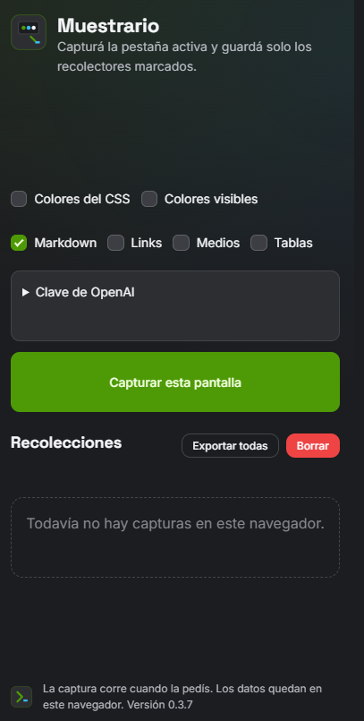
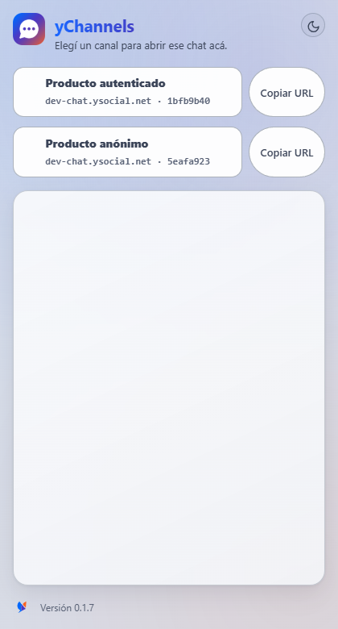

# Complementos Chrome

Cada carpeta de este directorio, salvo `docker/`, `marca/` y `docs/`, es un complemento de Chrome. Docker levanta un Chromium y carga todos los que tengan `manifest.json` Manifest V3 en la raíz de su carpeta.

Los que se creen después siguen [agent.md](agent.md): diseño KYZ, panel lateral, captura solo cuando se pide, y la clave del modelo fuera del paquete publicado.

## Complementos

### Muestrario

Panel lateral para la pestaña que estás viendo. Al abrirlo queda marcado solo **Markdown**. También puede tomar colores del CSS, colores visibles, links, medios y tablas, si los marcás en esa sesión.

**Capturar esta pantalla** lee la página y muestra el contenido por sección. **Normalizar y descargar**, debajo de ese botón, pide al modelo el Markdown de toda la extracción y lo baja como archivo. La clave API de OpenAI se guarda en este navegador desde **Clave de OpenAI**. El complemento no la cifra. En desarrollo puede leer `muestrario/.env`, que no se publica. El historial queda en el perfil de Chrome. No lee valores de formularios ni corre solo al navegar.

1. Abrí `chrome://extensions`.
2. Activá el modo de desarrollador.
3. Elegí «Cargar descomprimida» y señalá la carpeta `muestrario`.
4. Abrí el ícono de Muestrario, o usá `Alt+Shift+M`.



Para el zip de publicación, desde `muestrario` ejecutá `powershell -File .\empaquetar.ps1`. El script corta si un `.env` iba a entrar al archivo.

### yChannels

Selector de canales de Yoizen CX Suite. Cada chat es un botón. Al pulsarlo, la conversación se abre dentro del panel. Si la pestaña todavía tiene la burbuja de una versión anterior, el complemento la quita. Hoy están **Producto autenticado** y **Producto anónimo**, los dos en `dev-chat.ysocial.net`.

1. Abrí `chrome://extensions`.
2. Activá el modo de desarrollador.
3. Elegí «Cargar descomprimida» y señalá la carpeta `yChannels`.
4. Abrí el ícono de yChannels, o usá `Alt+Shift+Y`.



### Ciclo de release

Indicador del día. Al abrirlo muestra en qué fase del ciclo mensual estás: desarrollo, demo, alcance cerrado, freeze o build. Podés mirar otra fecha y saltar a las fechas del ciclo. Las fechas salen de la regla del ciclo y del calendario de feriados inamovibles; si el calendario compartido cambia una fecha, manda el calendario.

1. Abrí `chrome://extensions`.
2. Activá el modo de desarrollador.
3. Elegí «Cargar descomprimida» y señalá la carpeta `tiemposRelease`.
4. Abrí el ícono de Ciclo de release, o usá `Alt+Shift+R`.


## Todos juntos en Docker

La primera vez descarga cerca de 1 GB.

```bash
docker compose up -d --build
```

Abrí `https://127.0.0.1:3911`, aceptá el certificado local y entrá al escritorio. Chromium abre `chrome://extensions` con los complementos ya cargados. El puerto queda publicado solo en `127.0.0.1`. Si el escritorio no abre por HTTPS, probá `http://127.0.0.1:3910`.

Después de cambiar un complemento:

```bash
docker compose restart navegador
```

## Sumar otro complemento

Creá una carpeta hermana según [agent.md](agent.md), con su `manifest.json` en la raíz (Manifest V3). Al reiniciar el navegador del compose se copia y se carga junto con los demás. El nombre de la carpeta no puede llevar espacios ni comas.

Ejemplo: `otro-complemento/manifest.json`.

En este README, el complemento nuevo lleva su propia sección, con el uso y una captura en `docs/capturas/`.

## Marca

Muestrario usa KYZ. Los tokens están en `marca/kyz/` y el complemento los copia dentro de sí (`kyz/tokens`, `kyz/css`) porque Chrome solo lee archivos de su propia carpeta. Ciclo de release usa la marca Yoizen de `marca/yz/` (`palette.css`, `base.css`, `buttons.css`, `icon.svg`), copiada en `tiemposRelease/yz/`. No se inventan colores, radios ni sombras: salen de esos tokens.

El ícono de Muestrario es un muestreador: una pantalla con tres tomas (verde, cielo y claro) y un cuentagotas. El isotipo KYZ queda en el pie del panel.

